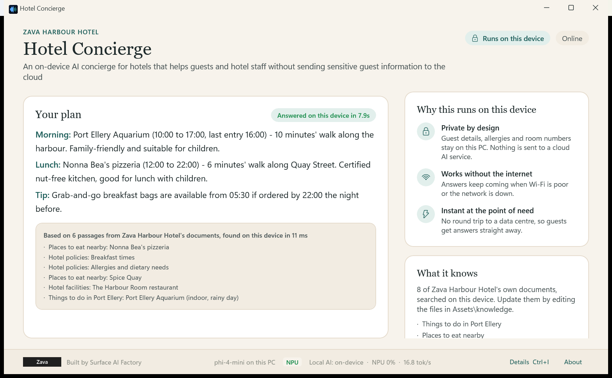
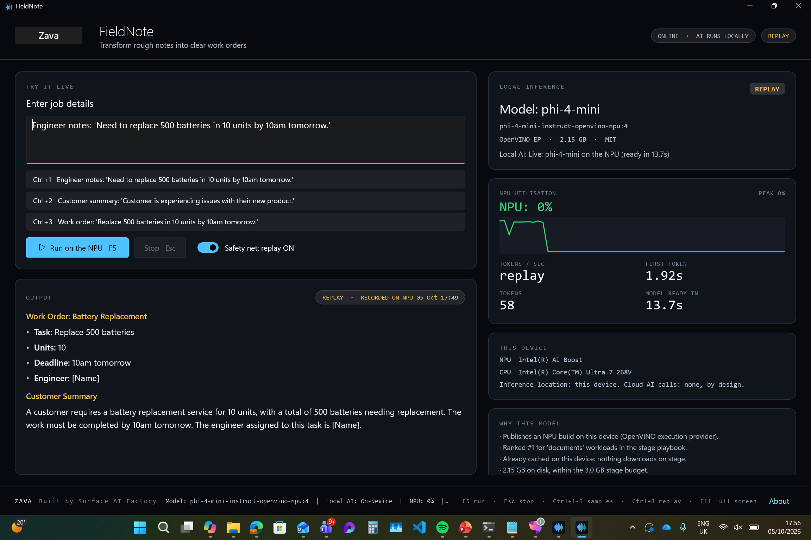
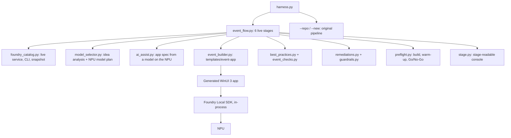

# Zava Live Build: Surface AI Factory harness, event edition

> **Built by Surface AI Factory.** A Microsoft Surface engineering prototype for Zava.
> All AI inference runs locally on-device. No data leaves your device.

Type a local app idea on stage. In under 25 minutes (typically about 9 on a fresh device, less once a
model has been prepared) you get a Zava-branded WinUI 3 app built for the idea's industry, running
real inference locally, stored on this device. Everything the original `ai-factory-harness` does
(audit, guardrails, branding P0, GPU consent, compliance report, GitHub publish) is still here, and
`--repo` and `--new` work exactly as before.



---

## Design rules for every generated app

1. **App first.** The screen is about the job the app does for its users: title, plain-language
   tagline, the modes (for example *Guest concierge*, *Staff assistant*, *Translate*), private context
   fields and realistic sample requests. Hardware words never appear in the app's own wording; a
   Section 11 check (`app-first-wording`) fails the build if they do.
2. **Industry design.** `industry.py` detects the idea's industry (hospitality, healthcare, retail,
   field service, finance, legal, education, public sector, software, or general) and sets the theme
   (palette, light or dark, heading font, corner radius), the wording, the modes, the context fields
   and the samples. Example requests written in quotes in the idea become the demo samples.
3. **Why local, in plain language.** The app shows *Why this runs on this device*: the local-AI
   drivers detected in the idea (private by design, works without the internet, instant, no
   per-question cost, easier compliance), written for that industry.
4. **Technical details are secondary.** Model, device, NPU use and speed sit in a slim ribbon at the
   bottom; `Ctrl+I` opens a details drawer for technical audiences. This still meets the Section 1.2
   transparency rules.
5. **Grounded when the idea needs it.** Ideas that mention knowledge, documents, manuals, policies or
   RAG get a local knowledge base (`Assets/knowledge/public` and `staff`), searched on the device
   (BM25), with sources under every answer. Hospitality ships a sample hotel pack.
6. **Stored on this device.** Apps are generated in `%USERPROFILE%\ZavaLiveBuilds`. Cloud-synced
   folders (OneDrive) are refused and redirected, because sync slows builds and can evict files.

## Use-case blueprints

The harness now has a use-case blueprint layer on top of the broad industry profiles. When an idea
clearly describes a known scenario, the generated app becomes a purpose-built product with custom
modes, context fields, sample prompts and local knowledge, rather than a generic assistant.

Current blueprints:

| Blueprint | Generated experience |
|---|---|
| Manufacturing quality inspection | **AI Quality Inspector** with Inspect, Diagnose and Assist modes, component references, fault codes, telemetry and calibration procedures |
| Patient aftercare companion | **Patient Companion** with aftercare Q&A, visit prep and clinician-approved local guidance |
| Contract risk review | **Contract Risk Reviewer** with clause review, negotiation prep and local legal playbooks |

Blueprints live in `use_case_blueprints.py`; their offline RAG packs live under `templates/knowledge/`.

## Speed: a 25 minute budget

Measured on a Surface with an Intel Core Ultra 7 268V, from the hotel concierge idea to GO FOR SHOW:
**5.6 minutes** on a device where the model had never been prepared, **about 2 minutes** after that.
A second, different app (field service) took 1.4 minutes.

| What | How |
|---|---|
| Hard budget | `--budget-minutes 25` (default). Download, build and warm-up are each limited to what is left |
| No packaging | Local, unpackaged build only: no MSIX, no publish, no symbols, English resources only, restore skipped on rebuilds |
| Shared model cache | Models and the compiled NPU cache live in `%LOCALAPPDATA%\ZavaLiveBuild`, shared by every generated app: each model is prepared once per device, not once per app |
| Shorter rehearsal | Preflight rehearses one sample per mode, then more while time remains, then compiles the backup model. `--full-rehearsal` runs everything |
| No slow AI assist | The optional sample-writing assist waits at most 25s, and is skipped when the idea already contains examples |
| NPU memory | Before the warm-up, models left loaded in the Foundry Local service are unloaded, and other apps using the NPU are named. If the NPU runs out of memory, preflight frees it and retries once |

## Answer quality from a small local model

Small models drift, so every generated app gets the same guard rails:

- **Format templates per mode** (for example one line per stop for itineraries; Steps then Escalate for
  procedures), with rules that only allow facts from the retrieved knowledge.
- **Document titles in the prompt** ("Places to eat nearby > Nonna Bea's"), so the model can tell a
  restaurant from an attraction or a procedure.
- **Low temperature (0.1)**, so rehearsed answers repeat on stage.
- **Answer clean-up**: empty sections ("Escalate: N/A"), stray template brackets and tips tacked onto
  every line are removed. Facts are never changed.
- **Repetition guard** that stops looping answers and stops generation on the device, plus one automatic
  retry if the model is still busy finishing the previous answer.
- **Rehearsal**: preflight runs the samples live and records them for the labelled replay.

## The live flow

```
python harness.py --idea "A field service assistant that turns rough job notes into a work order"
```

| Stage | What the audience sees |
|---|---|
| 1. Understand the idea | The workloads detected (documents, code, reasoning, speech, vision...) and the words that triggered them |
| 2. Design and select models | An **app design** card (industry, modes, grounding, why local) and a model card from the **live Foundry Local catalog**: NPU-only primary, pinned build, small NPU backup |
| 3. Generate the app | A complete WinUI 3 + Foundry Local SDK solution in `%USERPROFILE%\ZavaLiveBuilds`. Not a placeholder |
| 4. Guardrails | The ten Surface AI Factory sections plus **Section 11: Live Event Readiness** (now including the app-first, industry design, local-AI story, secondary details and local storage checks) |
| 5. Preflight | Builds the app, warms the model and rehearses each mode live, records the replay safety net, then shows a **GO FOR SHOW** board with the time used |
| 6. Publish | Local commit; pushes to `github.com/AI-Runs-Local` when `GITHUB_TOKEN` is set |

A sample console transcript is in [docs/sample-run-fieldnote.log](docs/sample-run-fieldnote.log).

### Measured on a Surface with Intel Core Ultra 7 268V (AI Boost NPU)

| App | Model on NPU | Tokens/sec | First token | Peak NPU | Cold NPU compile | Warm load |
|---|---|---|---|---|---|---|
| FieldNote | phi-4-mini | 10 to 15.7 | 1.6 to 1.8s | 95% | 157s | 13 to 19s |
| Zava Script Coach | qwen2.5-coder-1.5b | 19.5 | 1.2s | 80% | 71s | seconds |
| (backup) | qwen2.5-0.5b | 37.7 | 0.5s | 64% | 68s | 6s |

The cold compile is why preflight exists: it happens once, before the session, never on stage.

### Verified end to end

Two different ideas each went from a single `--idea` command to **GO FOR SHOW** on this device:

| Idea | Model chosen | Path exercised |
|---|---|---|
| Field service notes into work orders ("FieldNote") | phi-4-mini (cached) | Cached model, AI-designed spec, build, NPU warm-up, replay recording |
| PowerShell coding helper ("Zava Script Coach") | qwen2.5-coder-1.5b (not cached) | Presenter chose to download in preflight; model downloaded, compiled for the NPU and run live |

Failure paths tested deliberately on the built app:

| Scenario | Result |
|---|---|
| Primary model broken | Switched to the backup `qwen2.5-0.5b`, **still on the NPU**, live in 5.8s; preflight correctly reports NO-GO for the primary |
| Primary and backup broken | GPU consent declined (headless), dropped to labelled **Replay** mode, no crash |
| Safety net (`Ctrl+R`) | Plays outputs recorded on this NPU, labelled `REPLAY · RECORDED ON NPU <date time>` |
| Presenter keys right after launch | `F5`, `Esc`, `Ctrl+1..3`, `Ctrl+R`, `F11` all work without clicking into the app first |
| Unattended run, best-fit model not cached | Chose the best cached model, no download |
| Idea needing speech | Escalated (no NPU speech model on this device); safe default is a text-first NPU demo |

Compliance for generated apps: 51 PASS, 0 FAIL across the Surface AI Factory sections (the one
warning suggests adding Copilot+ PC APIs), and 12/12 in Section 11 after preflight.

### Sample apps

Two generated apps are produced in `.event-builds/` when you run the commands above
(git-ignored here, each its own repo with a stage runbook in `docs/DEMO-RUNBOOK.md`):

- **FieldNote**: rough job notes into a work order and customer summary (phi-4-mini).
- **Zava Script Coach**: explains PowerShell scripts and writes safe admin one-liners (qwen2.5-coder-1.5b).

---

## What makes the generated app bulletproof

| Risk on stage | Protection |
|---|---|
| Model changes or is missing | Exact build pinned (`alias:version`) in `Assets/app-config.json`; preflight downloads it while you are still online |
| Minutes-long first NPU compile | `--warmup` compiles into the app's own OpenVINO cache before the show |
| Primary model fails to load | Automatic switch to the pinned **backup model, still on the NPU** |
| Both NPU models fail | Presenter is asked before the GPU is used (`GpuFallbackConsentService`); declining keeps the demo on replay |
| Model stalls mid-demo | First-token watchdog (45s) moves the request to replay instead of hanging |
| Anything else | `Ctrl+R` safety net: outputs recorded **on this NPU** during preflight, always shown with an amber **REPLAY** badge and the recording time. Never presented as live |
| Keyboard dead after launch | Presenter keys are also hooked at the Win32 window level, so `F5` works even before you click into the app |
| Venue Wi-Fi | All inference is local; a header chip turns green ("OFFLINE, AI STILL RUNNING") for the airplane-mode moment |
| Battery | Preflight warns when the device is not on mains power |



### What the app shows

- **Header:** organisation, app name and what it does in one line, a "Runs on this device" chip and
  a network chip ("Offline, still working" for the airplane-mode moment)
- **The app:** mode tabs, a private context panel (for example the guest profile), the request box,
  three suggestions per mode and the answer, with the knowledge sources it used
- **Why this runs on this device**, **What it knows** (the local documents) and **This session**
  (memory only; `Ctrl+L` clears it for the next person)
- **Ribbon:** Zava logo, the `Built by Surface AI Factory` watermark, model status, device and a short
  transparency line, plus Details and About
- **Details drawer (`Ctrl+I`):** model build, execution provider, size, licence, device badge, live NPU
  graph, tokens/sec, time to first token, device names, why this model, recent runs and the replay switch

Presenter shortcuts: `F2`-`F4` modes, `F5` or `Ctrl+Enter` run, `Esc` stop, `Ctrl+1..3` samples,
`Ctrl+L` clear, `Ctrl+I` details, `Ctrl+R` replay, `F11` full screen.

---

## How models are chosen

1. Read the device's catalog: Foundry Local service (`/foundry/list`, `/openai/models`), then the CLI, then the bundled snapshot in `data/`. Model selection never fails because the service is slow or the network is down.
2. Only **NPU builds of chat models** are eligible as the stage primary.
3. Rank by a stage playbook per workload (for example `code` prefers `qwen2.5-coder-1.5b`, `documents` prefers `phi-4-mini`) and a 3 GB stage size budget.
4. Reasoning-distilled models (`*-reasoning`, `deepseek-r1`) are excluded: their hidden "thinking" looks like a hang on stage.
5. Pick a small cached NPU backup.
6. If the best fit is not cached, a guardrail asks: download it in preflight, use the best cached model, flag it, or abort. Unattended runs (`--non-interactive`) always choose the zero-download route; a model you pin with `--model` is never swapped.
7. If the idea needs **speech or vision** and this device has no NPU build for it, a guardrail asks before going further (recommended: a text-first NPU demo). GPU and CPU models are never used silently.

---

## Usage

```powershell
pip install -r requirements.txt

# Rehearse: see the model plan without building anything
python harness.py --idea "<your idea>" --plan-only

# The full live flow
python harness.py --idea "<your idea>" --no-push

# Pin a model, choose the app name, launch the app when it is GO
python harness.py --idea "<your idea>" --model phi-4-mini --name "Zava Shift Handover" --launch

# Unattended (CI or rehearsal loops): never prompts, never downloads when a cached model fits
python harness.py --idea "<your idea>" --non-interactive --overwrite

# Before every session, on the presentation device (folder name or full path)
python harness.py --preflight hotel-concierge

# Launch the app
powershell -File $env:USERPROFILE\ZavaLiveBuilds\<app-folder>\tools\Start-Demo.ps1
```

Generated apps go to `%USERPROFILE%\ZavaLiveBuilds` (override with `--work-dir`; cloud-synced
folders are redirected). Each app is its own git repo with `README.md`, `docs/DEMO-RUNBOOK.md`
(checklists, stage script and recovery playbook), `models/model_catalog.json` and
`.surface-ai-factory/` reports. Apps are built for this device only and are never packaged.

### Original modes (unchanged)

```powershell
python harness.py --repo <github-repo-url>                 # audit, remediate, publish
python harness.py --new "Build a local AI ..." --name x    # scaffold, then apply guardrails
python harness.py --repo <url> --report-only               # audit only
```

See the guardrail escalation, branding P0 and GPU fallback policy sections below.

Fixes to shared code that also benefit the original modes:

- The harness no longer crashes when its output is piped (for example from Copilot CLI) on a Windows console using cp1252.
- The RAG check no longer matches words like "storage" or "paragraph".
- Checks no longer read the harness's own previous reports in `.surface-ai-factory/`, which caused false findings on re-runs.

---

## Prerequisites

| Requirement | Why |
|---|---|
| Copilot+ PC with an NPU (Intel AI Boost, Qualcomm Hexagon, AMD Ryzen AI) | Inference target |
| [Foundry Local](https://aka.ms/foundry-local) | Model catalog, downloads, NPU execution providers |
| .NET 9 SDK | Builds the generated WinUI 3 app (x64 or ARM64) |
| Python 3.10+ | Runs the harness |
| `GITHUB_TOKEN` (optional) | Publishing to the GitHub org |

---

## Section 11: Live Event Readiness

| Rule | Checks |
|---|---|
| `model-pinned` / `npu-model` | Primary pinned to an exact NPU build |
| `backup-model` | A backup NPU model is configured |
| `warmup-mode` | App supports headless `--warmup` |
| `first-token-watchdog` | Stalls cannot hang the demo |
| `labelled-replay` | Safety net exists and is labelled REPLAY |
| `sample-prompts` | At least 3 rehearsed prompts with shortcuts |
| `inference-details` | Build, device, NPU graph, tok/s and TTFT available in the details drawer |
| `app-first-wording` | No hardware talk in the title, tagline, modes or actions (FAIL) |
| `industry-design` | An industry theme is applied |
| `local-ai-story` | The app explains why it runs on the device |
| `secondary-tech-details` | Model and device details live in the ribbon and drawer |
| `local-storage` | The app folder is on this device, not in a cloud-synced folder |
| `offline-indicator` | Network chip for the airplane-mode moment |
| `presenter-shortcuts` | Run, stop, samples, replay, full screen |
| `preflight` | Last preflight on this device was GO |
| `runbook` | `docs/DEMO-RUNBOOK.md` present |

---

## Branding is P0: Zava + the Surface AI Factory watermark

Branding remediation runs before every other fix. The exact string `Built by Surface AI Factory`
must appear in the main application UI, the About page, the README and the installer, alongside
Zava company branding and logo. All four AI transparency indicators (model in use, local AI status,
NPU utilisation, token generation progress) must be visible. Generated event apps satisfy all of
these out of the box, using the bundled Zava logo asset.

When a guardrail cannot be met automatically, the run pauses and asks for the next best route.
Nothing is skipped silently; every decision lands in the compliance report, and outstanding
branding items are written to `BRANDING-TODO.md`. `--non-interactive` picks the safest route and
never auto-waives or auto-aborts.

## GPU fallback policy

`NPU, then (ask the user) GPU, then Demo/Replay mode, then error.` The NPU is always attempted
first. GPU is only offered when the NPU cannot host the model, and only after explicit consent
(`IGpuFallbackConsentService`). The checker fails any repo that uses GPU paths without a consent
gate or sets a silent GPU default.

---

## Architecture



| File | Purpose |
|---|---|
| `event_flow.py` | The six-stage `--idea` flow, 25 minute budget, local output folder, `--preflight` entry |
| `industry.py` | Industry profiles (theme, wording, modes, context fields, samples) and local-AI drivers |
| `foundry_catalog.py` | Device catalog with three fallback layers |
| `model_selector.py` | Workload detection, stage playbook, model plan, app spec |
| `ai_assist.py` | Optional: a local model suggests samples; skipped when the idea has examples |
| `event_builder.py` | Generates the app, knowledge pack, README, runbook, model catalog |
| `event_checks.py` | Section 11 checks |
| `preflight.py` | NPU, Foundry, EP, cache/download, NPU memory, build, warm-up, power |
| `stage.py` | Banner, stage headers, cards, GO board |
| `templates/event-app/` | The app template (runtime ported from Local Transcription Studio) |
| `templates/knowledge/` | Sample knowledge packs per industry (hospitality) |

## Tests

```powershell
python -m unittest discover tests
```

25 unit tests cover catalog parsing, model selection rules, guardrail defaults, AI-assist parsing,
app generation (no leftover template tokens, pinned builds), industry design, local storage and the
Section 11 checks.

---

## Known limitations

- **Speech and vision ideas:** this device's Foundry Local catalog has no NPU builds for speech or
  vision models, so the harness escalates. The safe route builds a text-first NPU demo (for example
  working from a pasted transcript). Live microphone or camera input is not built yet.
- **Airplane mode:** inference is fully local, but a complete run with networking disabled has not
  been tested yet. Rehearse once offline after preflight (preflight must run online first to
  register the NPU execution provider and cache the catalog).
- **First NPU compile:** 1 to 3 minutes per model per app. Always run preflight before the session.
- **NPU counters:** some devices block the Windows GPU Engine counters; inference still runs on the
  NPU, and the runbook suggests showing Task Manager's NPU graph instead.
- **Copilot+ PC APIs** (Click To Do, Studio Effects, OCR and so on) are not integrated yet.

---

## Disclaimer

This harness and the apps it generates are **prototypes created for educational and
demonstration purposes** by the Microsoft Surface AI Factory team. Not for production use. No
Microsoft support or SLA. AI outputs may be inaccurate; review generated code before shipping.
Zava is a fictitious company. All AI inference is performed locally on-device.

*© Microsoft Corporation · Surface AI Factory*
