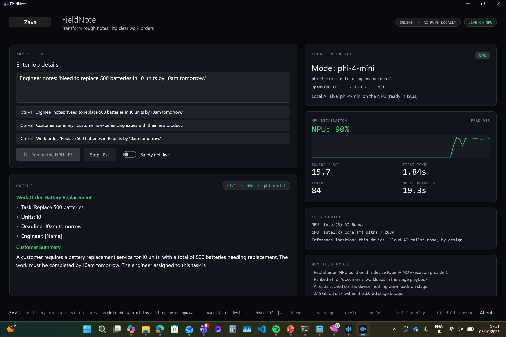
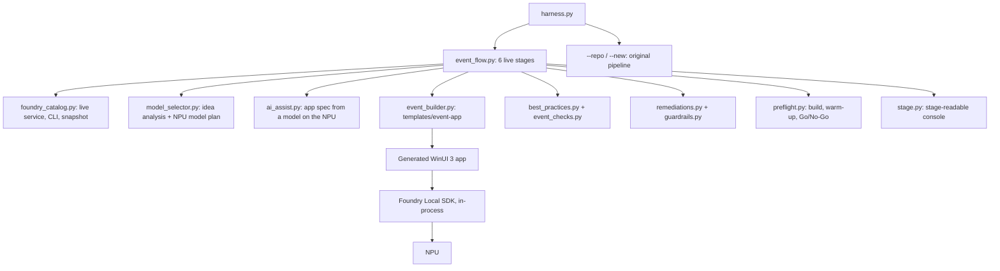

# Zava Live Build: Surface AI Factory harness, event edition

> **Built by Surface AI Factory.** A Microsoft Surface engineering prototype for Zava.
> All AI inference runs locally on-device. No data leaves your device.

Type a local app idea on stage. Within a few minutes the audience sees a Zava-branded
WinUI 3 app running real inference on the NPU, with the model, the device and the live
NPU utilisation shown on screen. Everything the original `ai-factory-harness` does
(audit, guardrails, branding P0, GPU consent, compliance report, GitHub publish) is still
here, and `--repo` and `--new` work exactly as before.



---

## The live flow

```
python harness.py --idea "A field service assistant that turns rough job notes into a work order"
```

| Stage | What the audience sees |
|---|---|
| 1. Understand the idea | The workloads detected (documents, code, reasoning, speech, vision...) and the words that triggered them |
| 2. Select models | A model card from the **live Foundry Local catalog** on this device: NPU-only primary, pinned build, size, licence, cached state, a small NPU backup and the reasons for the choice. A small model **on the NPU** then designs the app's title and sample prompts, streaming its tokens to the console |
| 3. Generate the app | A complete WinUI 3 + Foundry Local SDK solution. Not a placeholder |
| 4. Guardrails | The ten Surface AI Factory sections plus the new **Section 11: Live Event Readiness**, with Zava branding as P0 |
| 5. Preflight | Builds the app, runs it headless with `--warmup` to compile the model for the NPU and run every sample live, records the replay safety net, then shows a **GO FOR SHOW** board |
| 6. Publish | Local commit; pushes to `github.com/AI-Runs-Local` when `GITHUB_TOKEN` is set |

A sample console transcript is in [docs/sample-run-fieldnote.log](docs/sample-run-fieldnote.log).

### Measured on a Surface with Intel Core Ultra 7 268V (AI Boost NPU)

| App | Model on NPU | Tokens/sec | First token | Peak NPU | Cold NPU compile | Warm load |
|---|---|---|---|---|---|---|
| FieldNote | phi-4-mini | 10 to 15.7 | 1.6 to 1.8s | 95% | 157s | 13 to 19s |
| Zava Script Coach | qwen2.5-coder-1.5b | 19.5 | 1.2s | 80% | 71s | seconds |
| (backup) | qwen2.5-0.5b | 37.7 | 0.5s | 64% | 68s | 6s |

The cold compile is why preflight exists: it happens once, before the session, never on stage.

---

## What makes the generated app bulletproof

| Risk on stage | Protection |
|---|---|
| Model changes or is missing | Exact build pinned (`alias:version`) in `Assets/app-config.json`; preflight downloads it while you are still online |
| Minutes-long first NPU compile | `--warmup` compiles into the app's own OpenVINO cache before the show |
| Primary model fails to load | Automatic switch to the pinned **backup model, still on the NPU** |
| Both NPU models fail | Presenter is asked before the GPU is used (`GpuFallbackConsentService`); declining keeps the demo on replay |
| Model stalls mid-demo | First-token watchdog (45s) moves the request to replay instead of hanging |
| Anything else | `Ctrl+R` safety net: outputs recorded **on this NPU** during preflight, always shown with an amber **REPLAY** badge and the recording time. Never presented as live |
| Keyboard dead after launch | Presenter keys are also hooked at the Win32 window level, so `F5` works even before you click into the app |
| Venue Wi-Fi | All inference is local; a header chip turns green ("OFFLINE, AI STILL RUNNING") for the airplane-mode moment |
| Battery | Preflight warns when the device is not on mains power |


### What the app shows the audience

- **Local Inference** panel: model alias, exact build, execution provider, size, licence and a device badge (NPU / GPU (approved) / REPLAY)
- Live **NPU utilisation** % and a 30-second graph, read from the same Windows counters Task Manager uses
- **Tokens/sec**, **time to first token**, token count and model-ready time
- **This device**: NPU and CPU names
- **Why this model**: the selection reasons from the harness
- **Inference log** of every run (device, tok/s, TTFT, NPU peak)
- Zava branding, the `Built by Surface AI Factory` watermark, the transparency line and an About page

Presenter shortcuts: `F5` or `Ctrl+Enter` run, `Esc` stop, `Ctrl+1..3` samples, `Ctrl+R` replay, `F11` full screen.

---

## How models are chosen

1. Read the device's catalog: Foundry Local service (`/foundry/list`, `/openai/models`), then the CLI, then the bundled snapshot in `data/`. Model selection never fails because the service is slow or the network is down.
2. Only **NPU builds of chat models** are eligible as the stage primary.
3. Rank by a stage playbook per workload (for example `code` prefers `qwen2.5-coder-1.5b`, `documents` prefers `phi-4-mini`) and a 3 GB stage size budget.
4. Reasoning-distilled models (`*-reasoning`, `deepseek-r1`) are excluded: their hidden "thinking" looks like a hang on stage.
5. Pick a small cached NPU backup.
6. If the best fit is not cached, a guardrail asks: download it in preflight, use the best cached model, flag it, or abort. Unattended runs (`--non-interactive`) always choose the zero-download route; a model you pin with `--model` is never swapped.
7. If the idea needs **speech or vision** and this device has no NPU build for it, a guardrail asks before going further (recommended: a text-first NPU demo). GPU and CPU models are never used silently.

---

## Usage

```powershell
pip install -r requirements.txt

# Rehearse: see the model plan without building anything
python harness.py --idea "<your idea>" --plan-only

# The full live flow
python harness.py --idea "<your idea>" --no-push

# Pin a model, choose the app name, launch the app when it is GO
python harness.py --idea "<your idea>" --model phi-4-mini --name "Zava Shift Handover" --launch

# Unattended (CI or rehearsal loops): never prompts, never downloads when a cached model fits
python harness.py --idea "<your idea>" --non-interactive --overwrite

# Before every session, on the presentation device
python harness.py --preflight .event-builds\<app-folder>

# Launch the app
powershell -File .event-builds\<app-folder>\tools\Start-Demo.ps1
```

Generated apps go to `--work-dir` (use `.event-builds`, which is git-ignored). Each app is
its own git repo with `README.md`, `docs/DEMO-RUNBOOK.md` (checklists, stage script and
recovery playbook), `models/model_catalog.json` and `.surface-ai-factory/` reports.

### Original modes (unchanged)

```powershell
python harness.py --repo <github-repo-url>                 # audit, remediate, publish
python harness.py --new "Build a local AI ..." --name x    # scaffold, then apply guardrails
python harness.py --repo <url> --report-only               # audit only
```

See the guardrail escalation, branding P0 and GPU fallback policy sections below.

---

## Prerequisites

| Requirement | Why |
|---|---|
| Copilot+ PC with an NPU (Intel AI Boost, Qualcomm Hexagon, AMD Ryzen AI) | Inference target |
| [Foundry Local](https://aka.ms/foundry-local) | Model catalog, downloads, NPU execution providers |
| .NET 9 SDK | Builds the generated WinUI 3 app (x64 or ARM64) |
| Python 3.10+ | Runs the harness |
| `GITHUB_TOKEN` (optional) | Publishing to the GitHub org |

---

## Section 11: Live Event Readiness

| Rule | Checks |
|---|---|
| `model-pinned` / `npu-model` | Primary pinned to an exact NPU build |
| `backup-model` | A backup NPU model is configured |
| `warmup-mode` | App supports headless `--warmup` |
| `first-token-watchdog` | Stalls cannot hang the demo |
| `labelled-replay` | Safety net exists and is labelled REPLAY |
| `sample-prompts` | At least 3 rehearsed prompts with shortcuts |
| `inference-panel` | Build, device, NPU graph, tok/s and TTFT on screen |
| `offline-indicator` | Network chip for the airplane-mode moment |
| `presenter-shortcuts` | Run, stop, samples, replay, full screen |
| `preflight` | Last preflight on this device was GO |
| `runbook` | `docs/DEMO-RUNBOOK.md` present |

---

## Branding is P0: Zava + the Surface AI Factory watermark

Branding remediation runs before every other fix. The exact string `Built by Surface AI Factory`
must appear in the main application UI, the About page, the README and the installer, alongside
Zava company branding and logo. All four AI transparency indicators (model in use, local AI status,
NPU utilisation, token generation progress) must be visible. Generated event apps satisfy all of
these out of the box, using the bundled Zava logo asset.

When a guardrail cannot be met automatically, the run pauses and asks for the next best route.
Nothing is skipped silently; every decision lands in the compliance report, and outstanding
branding items are written to `BRANDING-TODO.md`. `--non-interactive` picks the safest route and
never auto-waives or auto-aborts.

## GPU fallback policy

`NPU, then (ask the user) GPU, then Demo/Replay mode, then error.` The NPU is always attempted
first. GPU is only offered when the NPU cannot host the model, and only after explicit consent
(`IGpuFallbackConsentService`). The checker fails any repo that uses GPU paths without a consent
gate or sets a silent GPU default.

---

## Architecture



| File | Purpose |
|---|---|
| `event_flow.py` | The six-stage `--idea` flow and `--preflight` entry |
| `foundry_catalog.py` | Device catalog with three fallback layers |
| `model_selector.py` | Workload detection, stage playbook, model plan, app spec |
| `ai_assist.py` | Streams an app spec from a local NPU model; falls back to rules |
| `event_builder.py` | Generates the app, README, runbook, model catalog |
| `event_checks.py` | Section 11 checks |
| `preflight.py` | NPU, Foundry, EP, cache/download, build, warm-up, power |
| `stage.py` | Banner, stage headers, cards, GO board |
| `templates/event-app/` | The app template (runtime ported from Local Transcription Studio) |

## Tests

```powershell
python -m unittest discover tests
```

---

## Disclaimer

This harness and the apps it generates are **prototypes created for educational and
demonstration purposes** by the Microsoft Surface AI Factory team. Not for production use. No
Microsoft support or SLA. AI outputs may be inaccurate; review generated code before shipping.
Zava is a fictitious company. All AI inference is performed locally on-device.

*© Microsoft Corporation · Surface AI Factory*
